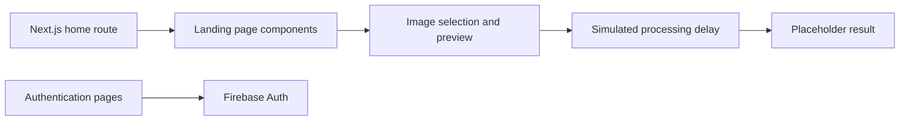

# FaceAI

**A frontend prototype for exploring an image-upload and face-completion experience.**

FaceAI brings together a product landing page, image preview, loading state, and authentication screens. It is useful for studying how to design the interface around an image-processing service before connecting a model backend.

## What is implemented

- Next.js pages with React and TypeScript.
- Product sections for features, example industries, and a demo.
- PNG/JPEG selection with a browser-generated image preview.
- A simulated processing delay followed by a placeholder result.
- Firebase authentication screens for sign-in, sign-up, and sign-out.
- Tailwind styling, Radix-based components, and Framer Motion animations.

The current demo does not call a face-completion model. Industry examples are interface content, not validated healthcare, security, or image-reconstruction capabilities.

## Architecture



## Run locally

Download the repository ZIP and extract it. Install a Node.js version supported by the Next.js version declared in `package.json`.

Create `.env.local` in the project root using your own Firebase project's configuration. The source reads these names:

```text
NEXT_PUBLIC_FIREBASE_API_KEY
NEXT_PUBLIC_FIREBASE_AUTH_DOMAIN
NEXT_PUBLIC_FIREBASE_PROJECT_ID
NEXT_PUBLIC_FIREBASE_STORAGE_BUCKET
NEXT_PUBLIC_FIREBASE_MESSAGING_SENDER_ID
NEXT_PUBLIC_FIREBASE_APP_ID
NEXT_PUBLIC_FIREBASE_MEASUREMENT_ID
```

```bash
npm install
npm run dev
```

Open the local URL printed by Next.js. Configure the Firebase sign-in providers used by the authentication form before testing that flow.

## Example interaction

Open the demo section, select a PNG or JPEG, and choose **Complete Face**. The selected image appears as a preview. The current implementation waits about two seconds and sets a placeholder image URL; it does not modify the uploaded face.

## Repository guide

| Path | Purpose |
|---|---|
| `app/` | Home page and authentication routes |
| `components/demo.tsx` | Upload preview and simulated result flow |
| `components/enterprise-face-completion.tsx` | Landing-page composition |
| `components/ui/` | Shared UI primitives |
| `lib/firebase.ts` | Firebase initialization and exported services |

## Development notes

`npm run build` and `npm start` are the declared production build and server commands. This repository remains a prototype: review placeholder assets, authentication redirects, and input validation before connecting a real service.

A useful contribution should distinguish visible UI behavior from actual model behavior and include a reproducible interaction to review.
